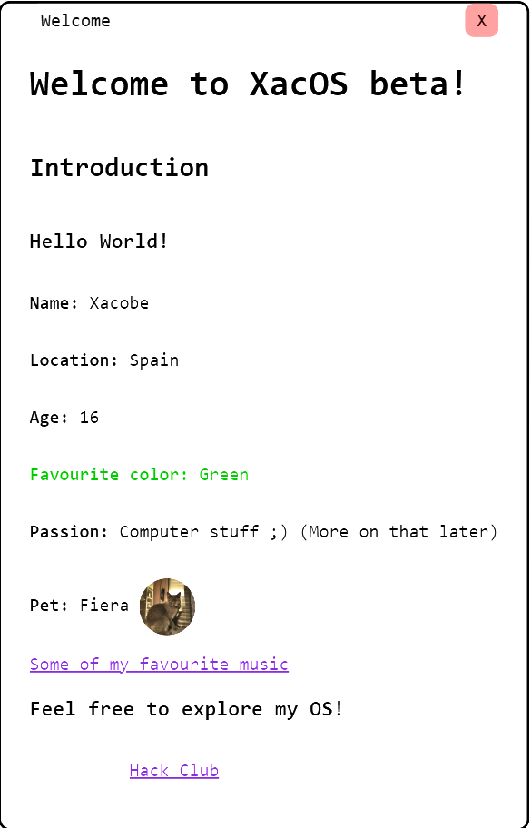
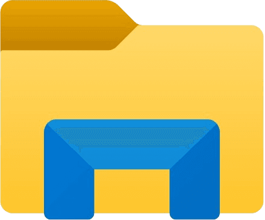

# XacOS

XacOS 2.0: A bloat-free (there are 6 apps) modern (it has blur) lightweight (it is HTML) operative system!
The main objective was to learn HTML, JavaScript and CSS, so expect the code to be a mess...

## What's new in 2.0

1. Added Setup: now the first time you boot XacOS, you will get a simple tutorial, the option to choose your favourite font and set your name and profile picture.
2. Taskbar calendar: hover over the date and time in the taskbar to see a calendar.
3. Added a new stardance-themed wallpaper.
4. Notepad: added a new feature to the notepad app, now you can open multiple notes at once and switch between them, and download them as a .txt file. You can also delete notes and edit their titles.
5. Animations: added new animations to the taskbar, windows and the welcome screen.
6. Paint: added a jspaint-based paint app, you can open it from the start menu.
7. Added a low graphics mode, which disables animations and blur effects to improve performance on low-end devices.
8. Added a security section in settings, where you can check if you´ve got the official and latest version of XacOS (Mostly a gimmick)
9 Now all settings are saved in the browser´s local storage, so you can keep your settings even if you close the browser.
10. Factory reset: now you can reset XacOS to its default settings from the settings app.
11. Some minor extra features and improvements (Translation: I forgot to write them down, but they are there)

# Hack Club
Huge thanks to hack club!
This was made following their WebOS Jam
https://jams.hackclub.com/batch/webOS

# Functions

## Welcome screen

The first screen that you encounter when starting up. (You can also open it clicking Welcome in the start menu) 
It is the main introduction to myself, citing some facts about me.

## Projects app

Here you can explore a couple of projects I've made by double clcking the icons

## Settings app

By clicking the 3 lines menu icon, you can choose to change the wallpaper, the font, the main system colors, see information about your PC and enable low graphics mode, factory reset and see the "security" status of your OS. 

## Taskbar
The taskbar shows the time, the OS name and the icons of your open programs.
You can click them to bring up the window

## Sticky notes app
A simple app that allows you to type whatever you want. Brainstorm, write your grocery list, etc. and save it onto XacOS or download it as a TXT to your own PC!

## Start menu
By clicking into the XacOS text in your taskbar, you can see and open all available apps in your XacOS.
